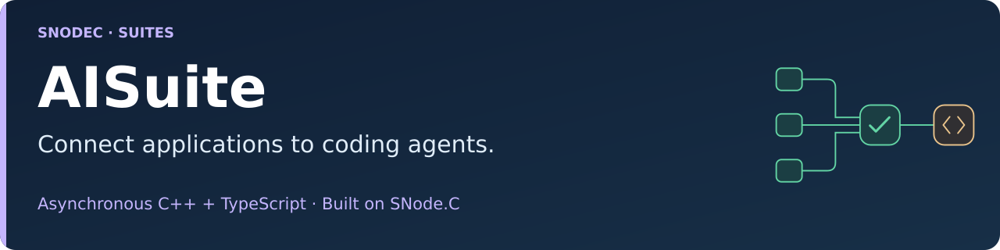
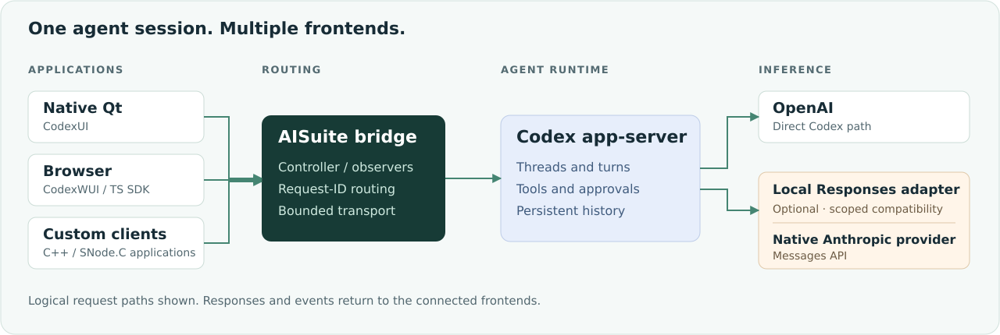

<!-- snodec:begin header -->
<a name="project-overview"></a>

<p align="center">
  <picture>
    <source media="(max-width: 600px)" srcset="docs/media/hero-mobile.svg">
  
  </picture>
</p>

<!-- snodec:begin organization -->
<p><a href="https://github.com/SNodeC" title="SNodeC organization"><picture><source media="(prefers-color-scheme: dark)" srcset="docs/media/nav/organization-dark.svg"></picture></a><br clear="all"></p>
<!-- snodec:end organization -->

# AISuite

<picture>
  <source media="(prefers-color-scheme: dark)" srcset="docs/media/snodec-chip-dark.svg">
  
</picture>
<!-- snodec:end header -->

<!-- snodec:begin status -->
[](https://github.com/SNodeC/AISuite/actions/workflows/build-and-test.yml) [](LICENSE)
<!-- snodec:end status -->

**Agent integration, built for event-driven applications.** AISuite provides asynchronous C++ libraries, a multi-client Codex bridge and a framework-neutral TypeScript frontend SDK, built on [SNode.C](https://github.com/SNodeC/snode.c#project-overview).

Connect native applications, browser frontends and custom clients to a Codex app-server. Keep transport and routing in AISuite; keep conversations, tools, approvals and persistent history with the agent runtime.

<!-- snodec:begin menu -->
<p>
  <a href="#quick-start" title="Start"></a>
  <a href="#install" title="Install"></a>
  <a href="docs/guides/build-from-source.md#page-overview" title="Build"></a>
  <a href="#first-success" title="Use"></a>
  <a href="#configuration" title="Configure"></a>
  <a href="#architecture" title="Architecture"></a>
  <a href="#contributing" title="Contribute"></a>
</p>

<!-- snodec:end menu -->

## Quick start

1. [Install](#install): get AISuite and its required dependencies.
2. [Use](#first-success): connect the bridge to a configured Codex app-server.
3. [Configure](#configuration): review runtime settings and access controls before deployment.

## First success

[Install AISuite](#install), then [run the bridge](#run-the-bridge) with a configured Codex app-server. For application code, continue to the [C++ and TypeScript integration examples](#integrate).

### Run the bridge

**You need:** AISuite installed with its applications, a configured Codex executable available to the same operating-system user, and two terminals. The generated protocol and Anthropic compatibility profile target Codex **0.162.1**; a different version needs compatibility checks, not an assumption of support. See the [pinned profile](docs/codex/responses-profile.md#page-overview).

**Terminal 1:** start the bridge:

```sh
codex-bridge --config-file /dev/null
```

The default configuration uses the owned stdio app-server and a private Unix frontend socket: a valid, private `XDG_RUNTIME_DIR` plus `/codex-bridge.sock`, otherwise `/tmp/codex-bridge-<uid>/codex-bridge.sock`. Network listeners are disabled until explicitly enabled.

**Terminal 2:** select the Unix client, using the same user and runtime environment as the bridge:

```sh
codex-bridge-client --config-file /dev/null \
  codex-bridge-client-unix --disabled=false
```

The bridge and interactive client use the same private runtime socket default when launched by the same user with the same environment. Once connected and the provider is ready, enter `threads`; use `help` to inspect commands and `quit` to exit.

**Expected result:** `connected using Unix JSONL`, followed by a `thread/list` JSON response after `threads`. An empty thread list is a valid result. This verifies transport, bridge routing and app-server readiness without creating a thread or making a paid model request. Provider-startup or protocol errors are failures, not successful empty responses.

#### Serve a browser frontend

With WebSocket support built, enable a loopback listener:

```sh
codex-bridge --config-file /dev/null codex-bridge-websocket-ipv4 --disabled=false \
  local --host 127.0.0.1 --port 8080
```

The same listener serves a built CodexWUI at `/` and upgrades `/codex` with the `codex` WebSocket subprotocol. Install the web artifact using [CodexWUI](https://github.com/SNodeC/CodexUI#project-overview). The default static root is the configured install data directory's `codexui/web`; the `codex` configuration subcommand's `--bridge-web-root PATH` option overrides it. An empty root disables static delivery without disabling WebSocket. **No Node process is needed to serve the installed application.**

> **Deployment boundary:** controller/observer roles are routing permissions, not user authentication or tenant isolation. Observer reads can include workspace files. Keep listeners private unless you provide an appropriate authenticated access boundary. Review [Configuration](#configuration) before sharing a session.

### Integrate

#### C++ / SNode.C

```cmake
find_package(AISuite CONFIG REQUIRED)
target_link_libraries(my_app PRIVATE AISuite::OpenAICodex)
```

Public Codex headers live under `aisuite/ai/openai/codex`; the namespace is `ai::openai::codex`. Use the frontend proxy for the full Codex protocol or `frontend::CodexAgent` for the common conversation/start-turn/interrupt facade. The underlying Codex APIs remain accessible through `backend()`.

Start with the [interactive client implementation](src/apps/codex-bridge-client) and [SDK architecture reference](docs/architecture/codex-bridge.md#page-overview).

#### TypeScript / browser

Using the locally built frontend SDK:

```ts
import {
  ClientConnection,
  CodexBridgeClient,
  WebSocketTransport,
} from "@snodec/codex-frontend";

const client = new CodexBridgeClient();
const connection = new ClientConnection(client);
const transport = new WebSocketTransport(connection, "ws://127.0.0.1:8080/codex");

client.onServerNotification("thread/started", notification => {
  console.log(notification.params?.thread);
});
```

The transport negotiates the bridge subprotocol. The application owns connection lifetime and reconnect intent. See the [SDK guide](packages/codex-frontend/README.md#page-overview) for request APIs and lifecycle details; the package is consumed from source by CodexWUI, so this is not an instruction to install a published npm release.

If the first run fails, use [build and runtime troubleshooting](docs/guides/build-from-source.md#troubleshooting).

## Capabilities

### Agent runtime and model provider

**Codex is the implemented agent runtime.** The normal OpenAI route stays direct; AISuite can also adapt an owned Codex app-server to its native Anthropic provider. That path supports the documented text-and-coding-tools profile, not a general Responses implementation or a Claude Code runtime. Images/audio, hosted search and thinking are outside that compatibility path. See the [provider guide](docs/guides/agent-providers.md#page-overview) and [compatibility profile](docs/codex/responses-profile.md#page-overview) for configuration and limits.

### What you can build

- **Shared agent workspace:** run `codex-bridge` and connect a controller plus observers to one app-server session.
- **Native integration:** link C++ targets into a SNode.C application and use typed, asynchronous agent or protocol APIs.
- **Browser frontend:** use `@snodec/codex-frontend` over WebSocket without reproducing server-side routing.

For ready-made applications, see **[Codex(W)UI](https://github.com/SNodeC/CodexUI#project-overview)**: **CodexUI** for the native Qt workspace and **CodexWUI** for the browser, both using this bridge.

### Libraries and applications

- `AISuite::OpenAICodex` — Typed backend and frontend SDKs, bridge routing, app-server and client transport adapters.
- `AISuite::Agent` — Common agent selection, conversation/start-turn/interrupt facade and lifecycle contracts.
- `AISuite::Model` — Provider-neutral inference, streaming, usage and cancellation contracts.
- `AISuite::Anthropic` — Native Anthropic Messages API provider; optional at build time.
- `@snodec/codex-frontend` — Framework-neutral TypeScript frontend proxy, connection lifecycle and generated protocol declarations.
- `codex-bridge` — Multi-client bridge application; optional integrated HTTP/WebSocket listener.
- `codex-bridge-client` — Interactive SNode.C frontend client.

#### One schema, two typed frontends

C++ views and TypeScript declarations are generated from the same pinned app-server schema and operation bindings. C++ values provide direct field access plus `getRaw()` for lossless access to the original JSON. Raw JSON-RPC submission remains available alongside typed methods.

Generation checks and cross-language equality tests detect drift. Protocol coverage describes the **selected schema**, not a promise that every server version implements every method or that observers may call every read-like API.

#### Transports that fit the application

The app-server side supports an owned **stdio JSONL** process or an externally managed app-server over **Unix, IPv4 or IPv6 WebSocket**. Frontend transports include Unix streams, TCP, optional TLS, HTTP/WebSocket and optional RFCOMM, depending on the installed SNode.C components and build options.

All carry the same bridge semantics. Transport selection does not create another agent implementation. See the [transport and lifecycle reference](docs/architecture/codex-bridge.md#page-overview).

## Architecture

<picture>
  <source media="(max-width: 600px)" srcset="docs/media/architecture-mobile.svg">
  
</picture>

Three boundaries keep the integration understandable:

1. **Applications own presentation and interaction.** Frontend SDKs correlate requests and deliver events; they do not retain a second conversation store.
2. **AISuite owns transport and routing.** The bridge translates request IDs, dispatches responses to their owners, broadcasts notifications and enforces controller/observer policy. Frames and outgoing queues are bounded.
3. **Codex owns the agent session.** Threads, turns, tools, approvals and persistence remain upstream. A model provider handles inference, not agent lifecycle.

“Stateless bridge” means **no retained Codex-domain state**—not an absence of connection state, pending requests or routing tables.

## Configuration

The [runtime configuration contract](docs/architecture/codex-bridge.md#configuration) separates the `codex` application section from named SNode.C transport instances. Inspect `codex-bridge codex --help` and the selected listener's `--help=expanded`; use `--write-config FILE` to save and exit, then `--config-file FILE` to load the settings. Protect exported files and logs.

Controller/observer roles are routing permissions, **not authentication or tenant isolation**. Observers may read workspace files and receive broadcasts; disabling observer requests does not redact notifications. Keep Unix sockets private and network listeners on loopback unless an external authenticated access boundary protects them. See [access and control policy](docs/architecture/codex-bridge.md#access-boundary) for the actual flags.

For browser listeners and static assets, see [Serve a browser frontend](#serve-a-browser-frontend). Build-time options belong in [Build from source](docs/guides/build-from-source.md#page-overview).

## Documentation

[Documentation index](docs/README.md#page-overview) — bridge, provider and frontend SDK guides.

| Topic | Reference |
| --- | --- |
| Bridge, SDKs, configuration and transport matrix | [Architecture](docs/architecture/codex-bridge.md#page-overview) |
| Agent and model-provider separation | [Providers](docs/guides/agent-providers.md#page-overview) |
| Anthropic through Codex: supported semantics | [Compatibility profile](docs/codex/responses-profile.md#page-overview) |
| Controller/observer boundaries | [Access boundary](docs/architecture/codex-bridge.md#access-boundary) |
| Browser/Node frontend integration | [TypeScript SDK](packages/codex-frontend/README.md#page-overview) |
| Native and browser consumers | [Codex(W)UI](https://github.com/SNodeC/CodexUI#project-overview) — CodexUI and CodexWUI |

When reporting a problem, include AISuite, SNode.C and Codex revisions, the transport, and a minimal reproduction. Remove credentials and private payloads from logs.

## Platforms and packages

The documented native build targets Linux with a C++20 toolchain, CMake 3.18+ and the SNode.C default-branch source installation described in the build guide. See the [build prerequisites](docs/guides/build-from-source.md#prerequisites) for optional transport and provider components.

### Install

The shared distribution-package pipeline does not publish AISuite binary packages yet; use the [source build and installation guide](docs/guides/build-from-source.md#page-overview).

## Releases

No GitHub release has been published yet. Build from the source checkout; future release notes will appear on the [releases page](https://github.com/SNodeC/AISuite/releases). The frontend SDK is consumed from source, not a published npm release.

## Contributing

[Engineering instructions for coding agents](AGENTS.md).

[Report an issue](https://github.com/SNodeC/AISuite/issues) with the revisions, transport and sanitized reproduction described in [Documentation](#documentation). The [build and verification guide](docs/guides/build-from-source.md#development-checks) covers the existing checks.

<!-- snodec:begin ecosystem -->
## Ecosystem

Depends on [SNode.C](https://github.com/SNodeC/snode.c#project-overview) · Used by [CodexUI and CodexWUI](https://github.com/SNodeC/CodexUI#project-overview)
<!-- snodec:end ecosystem -->

<!-- snodec:begin footer -->
Choose either [MIT](LICENSE-MIT) or [LGPL-3.0-or-later](LICENSE-LGPL-3.0-or-later). AISuite is an independent SNode.C-based project, not an official OpenAI or Anthropic SDK.

Maintainer: [Volker Christian](https://github.com/VolkerChristian). [Organization](https://github.com/SNodeC) · [Contributing](#contributing) · [Security](https://github.com/SNodeC/.github/blob/main/SECURITY.md)
<!-- snodec:end footer -->
